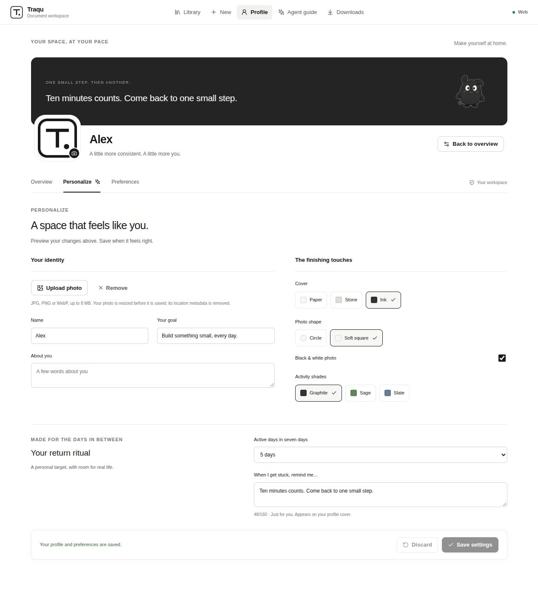
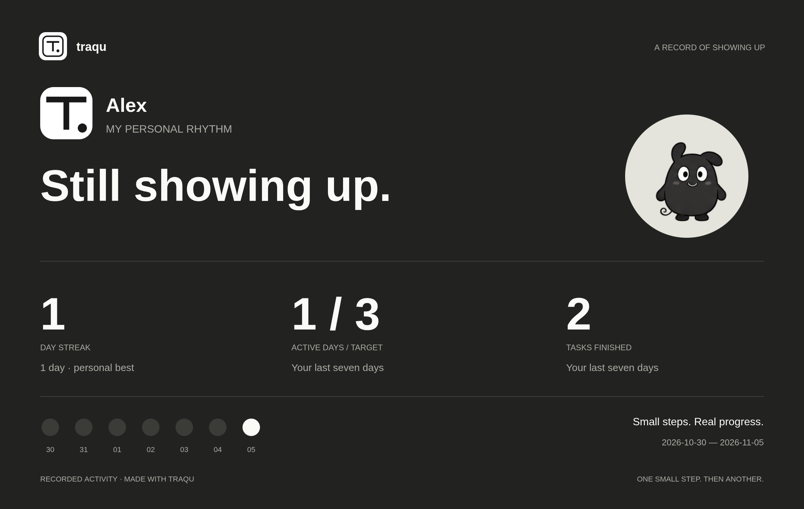

<p align="center">
  <picture>
    <source media="(prefers-reduced-motion: reduce)" srcset="docs/readme/hero.png">
    
  </picture>
</p>

<p align="center"><b>your next chapter, one checkbox at a time.</b><br>Turn a PDF, a Word document, or that very ambitious pasted plan into a roadmap you can actually follow.</p>

<p align="center">
  <a href="#get-the-app"><b>↓ Get the app</b></a> &nbsp; · &nbsp;
  <a href="#see-it-in-action"><b>See it in action</b></a> &nbsp; · &nbsp;
  <a href="#run-from-source"><b>Run from source</b></a> &nbsp; · &nbsp;
  <a href="#buy-me-a-coffee"><b>Buy me a coffee ☕</b></a>
</p>

<p align="center"><code>Android · Linux · Windows · macOS</code> &nbsp; <code>offline ready</code> &nbsp; <code>no account</code> &nbsp; <code>saved on your device</code></p>

---

## From “saved for later” to “done.”

The study plan is in a PDF. The project roadmap is in a chat. The next step is somewhere on page 37.

**Traqu gives the plan a place to live.** Import it, keep its sections and useful context, then work through one clear day at a time. Open a week, choose a dated day, and start its checklist. Check something off. Add a note. Come back tomorrow with your progress still there.

<picture>
  <source media="(prefers-reduced-motion: reduce)" srcset="docs/readme/flow.png">
  
</picture>

<sub>The animations above illustrate the workflow. The desktop captures below show the real app.</sub>

## Get the app

Pick your device. Bring a plan. Start with Day 1.

<table>
  <tr>
    <td width="50%" valign="top">
      <h3> &nbsp; Android</h3>
      <p>Your daily plans, progress and little companion. Right on your phone.</p>
      <p><a href="https://github.com/Gurtejhundal/Traqu/releases/download/android-v1.6.1/Traqu-Android.apk"><b>↓ Download APK</b></a></p>
      <sub>Android 7 or newer</sub>
    </td>
    <td width="50%" valign="top">
      <h3> &nbsp; Windows</h3>
      <p>A quiet home for your plans, ready whenever you are.</p>
      <p><a href="https://github.com/Gurtejhundal/Traqu/releases/latest/download/Traqu-Windows-x64.exe"><b>↓ Intel / AMD</b></a> &nbsp; · &nbsp; <a href="https://github.com/Gurtejhundal/Traqu/releases/latest/download/Traqu-Windows-arm64.exe"><b>↓ ARM64</b></a></p>
      <sub>Windows 10 / 11 · ARM64 requires Windows 11</sub>
    </td>
  </tr>
  <tr>
    <td width="50%" valign="top">
      <h3> &nbsp; macOS</h3>
      <p>Make a little room for the next small step.</p>
      <p><a href="https://github.com/Gurtejhundal/Traqu/releases/latest/download/Traqu-macOS-arm64.dmg"><b>↓ Apple Silicon</b></a> &nbsp; · &nbsp; <a href="https://github.com/Gurtejhundal/Traqu/releases/latest/download/Traqu-macOS-x64.dmg"><b>↓ Intel</b></a></p>
      <sub>macOS 13 or newer · DMG installers</sub>
    </td>
    <td width="50%" valign="top">
      <h3> &nbsp; Linux</h3>
      <p>Your workspace, at home on your desktop.</p>
      <p><a href="https://github.com/Gurtejhundal/Traqu/releases/latest/download/Traqu-Linux-x64.AppImage"><b>↓ AppImage</b></a> &nbsp; · &nbsp; <a href="https://github.com/Gurtejhundal/Traqu/releases/latest/download/Traqu-Linux-x64.deb"><b>↓ DEB</b></a></p>
      <sub>64-bit Intel / AMD · Ubuntu 22.04+ baseline</sub>
    </td>
  </tr>
</table>

<p align="center"><sub>Works offline &nbsp; · &nbsp; No account &nbsp; · &nbsp; Saved on your device</sub></p>

<details>
<summary>Installation help &amp; release details</summary>

- **Android:** open the APK on your phone, allow installation from your browser or file manager when prompted, then open Traqu. [Android guide](docs/ANDROID.md).
- **Windows:** open the setup file and choose an installation folder.
- **macOS:** open the DMG and drag Traqu to Applications. [Apple Silicon ZIP](https://github.com/Gurtejhundal/Traqu/releases/latest/download/Traqu-macOS-arm64.zip) · [Intel ZIP](https://github.com/Gurtejhundal/Traqu/releases/latest/download/Traqu-macOS-x64.zip).
- **Linux:** install the DEB with your package manager, or allow execution in the AppImage's file properties and open it. AppImage may need FUSE 2. Linux ARM builds are not provided.

Desktop installers include the Python engine. Windows ARM64 includes a native ARM64 backend. Desktop builds are unsigned; Windows may show SmartScreen and macOS may require approval in Privacy & Security. Android signing and update details are in the Android guide. Export a workspace backup before uninstalling or replacing an installation.

Downloads do not require GitHub sign-in. Android APKs are released independently after offline emulator tests pass. Desktop releases follow source and packaged-app tests on all five desktop targets.

[Download guide](https://traqu.vercel.app/downloads) · [All releases & checksums](https://github.com/Gurtejhundal/Traqu/releases)

</details>

## Plan with an AI agent

[Open the agent guide](https://traqu.vercel.app/agents) · [Download SKILL.md](frontend/public/agents/SKILL.md) · [JSON template](frontend/public/agents/roadmap-example.json) · [Markdown template](frontend/public/agents/roadmap-example.md)

Give your agent a daily format: Week → Day, one action per checkbox, and dates only when confirmed. Keep timing, optional work, links, and notes attached to their actions. JSON preserves the most detail; a selectable-text PDF can accompany it. Traqu uses a deterministic, layout-aware parser, not a trained language model. The skill describes formats covered by regression tests.


Dated daily planners now keep individual time slots, weekly context, durations, optional status, and source-page references. On the supplied private 40-page benchmark: **724 timed tasks across all 212 dates**, including 56 optional tasks. The original file is not published. See [parser evaluation and limits](docs/PDF_IMPORT.md).

## Meet Traqu on the web

[Explore Traqu](https://traqu.vercel.app) · [Download & setup](https://traqu.vercel.app/download) · [Docs & creator](https://traqu.vercel.app/docs)

The public site explains the app with real screenshots, a recorded GIF, an interactive Qu, installation and AI connection guides, project manuals, and optional coffee support. It is a static three-page website; the desktop and Android apps keep their own local workspaces. Its [plain HTML/CSS/JavaScript source](website) and [publishing guide](docs/WEBSITE.md) are in this repository.

## Connect your AI agent locally

Traqu has a local **MCP server** for reading roadmaps, dated days, tasks and real activity from your desktop workspace. Enable editing explicitly to create plans, add notes and update checkboxes through the same validation as the app. It runs over stdio, with no public endpoint or cloud database.

In desktop version **1.6.1+**, open **Profile → Preferences → AI connections** and choose **Codex, Claude Desktop, Claude Code, Gemini CLI, Antigravity or Cursor**. Choose read-only or editing access, confirm setup, then restart your AI app. The server is bundled: no Python, Node.js or terminal setup is needed.

For free ChatGPT, Claude or Gemini browser chats, **Copy chat prompt** provides the full Traqu format and optionally one chosen roadmap. Paste it into your chat and import the result. This is a manual copy/import workflow, not live synchronization.

[Client setup, source installation, available tools and access modes](docs/MCP.md).

## One day at a time

**Week folders → dated day cards → today’s checklist.** Start Day 1, keep its instructions beside each action, and move on when you’re ready. Completed day cards fade and their titles cross out. You can revisit or reopen any day.


**Your corner of Traqu** keeps your name, bio, goal, timezone, week start, task spacing, and motion preferences together. A GitHub-style contribution calendar records real completions; select a date to see that day’s work, or replay the snake’s path through your activity.





**Your corner, your way.** Overview, Personalize and Preferences keep your profile easy to navigate. Add and crop a photo, choose a cover and activity shades, set a personal seven-day target and leave a note for the days you need a little momentum. Preview a high-resolution profile card with your photo, Qu and real progress; choose its finish, headline and visible details, then save it or share it with a friend. [Profile audit and update](docs/PROFILE_UPDATE.md).

History starts with completions recorded in this version. Imported checkmarks do not fabricate past activity. Same-day undo removes the task’s credit; reopening later keeps the earlier record. Workspace backups include profile and history; restoring keeps an existing profile and merges history by event identity.

For an older flat import whose saved source contains explicit day headings and checkboxes, choose **Preview daily copy → Create daily copy**. Review the day/action counts first. Matching titles keep their completion state and notes in source order; unmatched custom rows remain in the original plan. The original roadmap and full source stay available.

## See it in action

<p align="center">
  <picture>
    <source media="(prefers-reduced-motion: reduce)" srcset="docs/screenshots/roadmap.png">
    
  </picture>
</p>

<p align="center"><sub>Real Electron captures · sample plans · no personal workspace data</sub></p>

<table>
  <tr><th>Your plans, together</th><th>One section, in focus</th></tr>
  <tr>
    <td valign="top"><a href="docs/screenshots/library.png"></a></td>
    <td valign="top"><a href="docs/screenshots/roadmap.png"></a></td>
  </tr>
</table>

<details>
<summary>Take a closer look at importing a plan</summary>


</details>

## A little less friction. A little more follow-through.

| When your plan looks like… | Traqu helps you… |
| --- | --- |
| A long PDF, DOCX, or pasted chat response | Import it into sections and tasks |
| Weeks, phases, sprints, or several parallel tracks | Keep a structure you can navigate |
| Notes, tables, code, and supporting material | Keep useful context with the roadmap |
| Too much to look at all at once | Choose a section and focus on the next step |
| “I should probably revisit this” | Add notes, checklists, counters, bookmarks, labels, or due dates |
| A plan you want to take elsewhere | Export to PDF or Word |
| Something you want to keep to yourself | Work locally, with no account or hosted sign-in |

**Your work stays on your computer.** The desktop app starts its own private local service and saves roadmaps in SQLite in your OS user-data folder. Updating the app keeps that folder separate from the installed program.

Use **File → Show Data Folder** to find your workspace and **File → Show Logs** for diagnostics. On Linux and Windows, press **Alt** to reveal the menu.

## Small shortcuts. Useful momentum.

| Action | Linux / Windows | macOS |
| --- | --- | --- |
| New roadmap | `Ctrl + N` | `Cmd + N` |
| Back to the library | `Ctrl + Shift + L` | `Cmd + Shift + L` |
| Reload the workspace | `Ctrl + R` | `Cmd + R` |

Native menus also provide clipboard actions, zoom, full-screen mode, and PDF/Word save dialogs. Traqu remembers your window size between launches.

## Run from source

For development, use **Node.js 24** and **Python 3.12**:

```bash
npm ci
npm run setup
npm start
```

Build an installer for your current OS with `npm run dist`. Output goes into `release/`. Each OS and CPU architecture needs its own native build; the desktop workflow handles Linux, Windows, Apple Silicon, and Intel Mac builds.

| Need the details? | Start here |
| --- | --- |
| Desktop architecture, builds, tests, and moving an existing database | [Desktop guide](docs/DESKTOP.md) |
| Run the web app and API separately, or use the Windows browser launcher | [Development guide](docs/DEVELOPMENT.md) |
| Source and regeneration notes for these animations | [README media](docs/readme/README.md) |

React + Vite for the workspace. FastAPI + SQLAlchemy for the import engine. SQLite for local data. Electron for the desktop shell.

<details>
<summary>A few practical limits</summary>

- PDFs need selectable text. Scanned image PDFs need OCR before import.
- Desktop is a private, account-free local workspace. The public website is a product and documentation site, with no hosted plan workspace. Export local workspace backups.
- The desktop workspace starts separately from an existing web database; the [migration instructions](docs/DESKTOP.md#local-data-and-migration) explain how to preserve existing progress.
- This version does not include cloud sync, automatic updates, or application-level database encryption.

</details>

## A little company for big plans

<p align="center"></p>

Meet **Qu**, a little ink creature for small, steady progress. Click to hop, double-click to run, or use S to sway, W to wave, and Escape to rest. At rest, Qu’s pupils follow the cursor. Short page transitions and gentle press feedback give the workspace a little life, with reduced-motion support. Import review catches incomplete plans before saving; JSON backup/restore and stable editing help keep progress safe.

[Design and motion prompt](docs/DESIGN_PROMPT.md) · [Meet Qu](docs/CHARACTER.md) · [Import, backup, and hosting details](docs/RELIABILITY.md)


## Buy me a coffee

<p align="center">
  <picture>
    <source media="(prefers-reduced-motion: reduce)" srcset="docs/readme/support.png">
    
  </picture>
</p>

If Traqu makes your day a little easier, you can buy me a coffee. Thanks for supporting the next update. A GitHub star is always welcome too.

<p align="center">
  <a href="docs/readme/upi-qr.png"></a><br>
  <b>Scan with a UPI app · coffee is always appreciated.</b><br>
  <sub>Gurtejbir Singh · <code>gurtejbir.29107@okhdfcbank</code></sub>
</p>

---

<p align="center"><b>Traqu</b> — plan. focus. follow through.<br><sub>Made by <a href="https://github.com/Gurtejhundal">Gurtejbir Singh</a> · your plans, at your pace.</sub></p>
