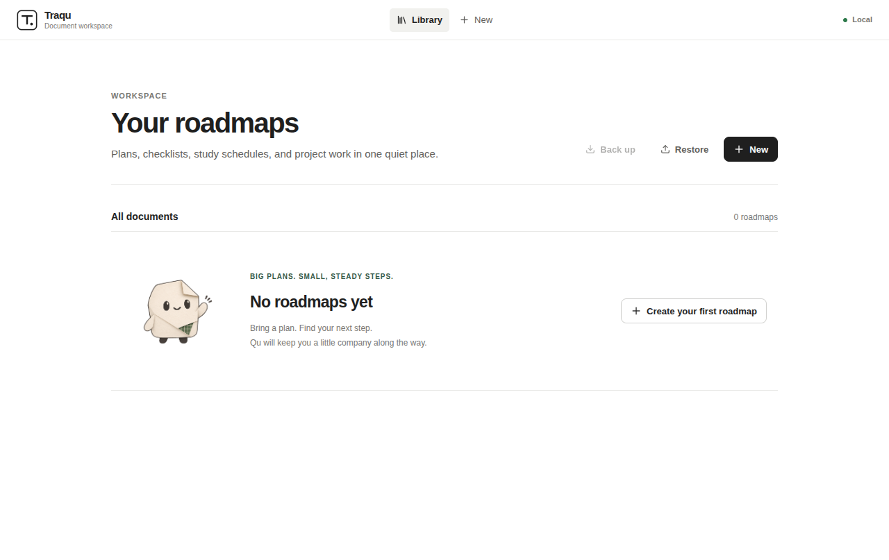
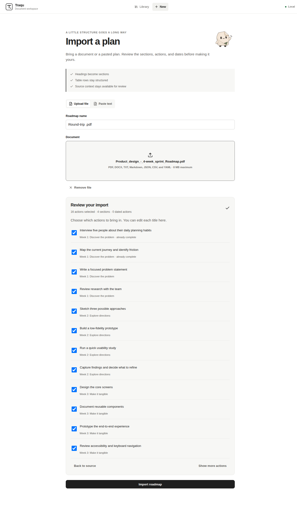

# Traqu 1.3 — audit fixes and design verification

Verified locally on Linux on 2026-11-03. This report distinguishes source and packaged checks from native builds that still require CI.

## Flow health

1. **Bring a plan:** imports now show a review step, editable titles, and source-completeness warnings. Markdown checkbox state, recurring actions, numbered actions, CSV/YAML, and the supplied day-row assignment format have regression coverage. All 269 supplied problem IDs and 20 contests become 289 dated tasks; missing source weeks are reported.
2. **Keep working:** structural edits retain surviving identities and order, reject stale revisions, and preserve duplicate section labels. Older SQLite tables migrate with foreign-key checks and a consistent pre-migration snapshot.
3. **Take work with you:** workspace JSON backup/restore creates validated copies atomically. Native Chromium PDF printing retains readable multilingual text and dates; Word export round-trips without adding attribution as tasks. JSON remains the exact application backup.
4. **Feel at home:** Qu appears in quiet supporting states. Short route arrivals, press responses, capped list staggers, and progress transitions give feedback. CSS and JavaScript honor reduced motion, including section navigation.
5. **Stay private:** desktop authentication remains private and offline. Hosted workspaces ignore caller-supplied owner headers and require signed sessions plus durable storage. Unconfigured hosted workspace requests fail closed; download and agent information stays accessible.

## Checks

- Backend: **117 passed, 5 skipped**. Skips are unavailable private PDF fixtures, not passing PDF checks.
- Frontend: **24 passed**, lint clean, production build successful.
- Desktop unit checks: **10 passed**, including print escaping and isolation.
- Electron end-to-end: **2 source scenarios and 2 packaged Linux scenarios passed**. Covers import/review, completion, editing, restart persistence, desktop navigation, session protection, backup/restore, and reduced motion.
- Separate real Chrome browser check: import/review, browser PDF printing, and website downloads passed without page errors. The development-mode print module incompatibility discovered by this check was fixed with a shared ES module.
- Multilingual PDF/Word probe: Punjabi, Chinese, emoji, checked state, and section dates rendered and re-imported. Font substitution can affect extracted Unicode glyph variants; use JSON for exact text.
- A 60-page/720-task PDF responsiveness probe measured a concurrent health request at about **4 ms**, versus **1.28 s** before offloading. This measures API responsiveness, not faster PDF extraction.

## Visual evidence

Current captures come from the real app, not mockups:

| Empty library | Import review |
| --- | --- |
|  |  |

[Animated desktop walkthrough](screenshots/desktop-demo.gif) · [Reusable design prompt](DESIGN_PROMPT.md)

Matching before/after captures and detailed export/performance probes are retained locally in ignored `tmp/traqu-motion/`; personal source files and disposable profiles are not published.

## Remaining external work and limits

- New Windows, both macOS architectures, and Ubuntu-baseline installers need their native CI jobs. Local Linux success does not verify those systems.
- Vercel project status is readable, but environment access returned **403**. Production database durability and the stable signing secret could not be inspected or configured. Hosted workspace readiness must be checked after deployment; it may remain disabled until configured.
- Publisher signing/notarization needs real credentials. Installers remain unsigned until those are supplied. Automatic update installation and cloud sync are not implemented.
- Scanned PDFs still require OCR. Parsing is deterministic; no neural model was trained or universal PDF accuracy claimed.
