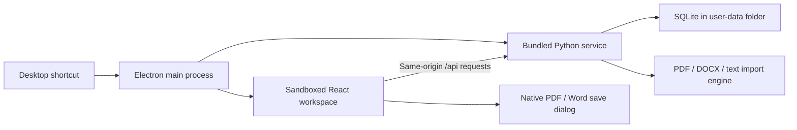

# Traqu desktop

Traqu's desktop edition packages the existing React workspace and FastAPI import engine together. It can run without an account, an internet connection, Node.js, or Python installed on the user's computer.

## Architecture and choice of framework

The existing import engine uses Python libraries for PDF layout extraction, DOCX parsing, and SQLAlchemy persistence. Replacing that engine would risk losing document fidelity. The desktop wrapper therefore reuses it as a bundled child process.

| Approach | Fit for this project |
| --- | --- |
| Electron + frozen Python service | Chosen. Reuses React and Python, provides the same Chromium rendering on each OS, and supports native menus and download dialogs. Costs more disk space and memory. |
| Tauri + Python sidecar | A viable smaller-shell alternative, but still needs a platform-specific Python bundle and adds a Rust toolchain and system-WebView differences to this project. |
| Python WebView wrapper | Reuses Python, but adds platform-specific WebView dependencies and a separate desktop integration layer. |

These are engineering tradeoffs for this codebase, not a size or performance benchmark. No cross-platform performance measurements have been made.



Electron launches `backend/desktop_server.py` during development or the PyInstaller executable after packaging. Python binds to `127.0.0.1` on a port assigned by the OS and reports the port through its stdout pipe. Electron waits for a Traqu-specific API response before showing the workspace.

The Python desktop host serves both the compiled Vite app and `/api` from the same origin. BrowserRouter deep links survive reloads. Missing JS, CSS, and image files return 404 rather than the HTML fallback. Desktop builds force `/api` and the existing `local_owner` owner key, so web deployment environment values cannot send desktop requests to a hosted API.

## Desktop behavior

- Animated startup screen, with reduced-motion support.
- Native application menus, clipboard shortcuts, zoom, and full-screen mode.
- `Ctrl/Cmd+N`: new roadmap. `Ctrl/Cmd+Shift+L`: library. `Ctrl/Cmd+R`: reload.
- PDF and Word exports use the OS save dialog.
- Single-instance behavior brings the existing window forward.
- Window size and maximized state persist between launches.
- Closing the last window quits on Linux and Windows. On macOS, closing the window leaves the app available from its Dock icon; Quit stops the app and local service.
- The child service stops when its parent pipe closes, including after an Electron crash. Normal exit gives pending requests a short graceful-shutdown window.
- Startup failures and unexpected backend exits show a native error dialog with the data/log location.

## Local data and migration

| OS | Default workspace directory |
| --- | --- |
| Linux | `$XDG_CONFIG_HOME/Traqu`, normally `~/.config/Traqu` |
| Windows | `%APPDATA%\Traqu` |
| macOS | `~/Library/Application Support/Traqu` |

Use **File → Show Data Folder** to resolve the exact location on your machine. The folder contains `roadmap.db`, `window.json`, and `logs/desktop.log`. The log rotates after 2 MB. Installed program files and user data are separate, so replacing the app does not replace the workspace. `TRAQO_DATA_DIR` can select an alternate absolute data directory; the end-to-end tests use disposable temporary directories.

The desktop app starts with its own workspace. To bring an existing local web workspace across:

1. Quit Traqu and stop the web backend so neither database is being written.
2. Make backup copies of both databases.
3. Copy the web app's `backend/roadmap.db` into the desktop data folder as `roadmap.db`.
4. Reopen the desktop app. Existing schema migrations run at startup.

This migration preserves records using the default `local_owner` key. A web installation configured with another owner key needs its records migrated to that key separately. Pasting/importing a source roadmap is also supported, but does not preserve saved progress or task blocks like copying the database does.

## Desktop boundaries

The desktop API requires a random 256-bit session credential. Electron attaches it only to requests for the exact local origin; renderer JavaScript does not receive it. Other local processes and ordinary browser tabs receive 401 for API requests without that credential. Host validation rejects unrelated hostnames to limit DNS rebinding.

The renderer uses `sandbox: true`, context isolation, disabled Node integration, a Content Security Policy, permission requests denied except sanitized clipboard writes from the private workspace, and blocked webviews. External HTTP(S)/mail links open in the system handler. Other protocols are rejected. External pages cannot navigate into the privileged app window. These settings follow [Electron's security guidance](https://www.electronjs.org/docs/latest/tutorial/security).

This is a single-user desktop workspace. SQLite is stored as a normal local file, without application-level encryption. The web API's existing local-owner header is not multi-user authentication. The desktop session gate applies only to the desktop host; the ordinary web backend retains its current behavior.

## Develop and package

Use Node.js 24 and Python 3.12. Python 3.11–3.13 may also work, but the CI baseline is 3.12. Python is required only for development/building.

```bash
npm ci
npm run setup
npm start
```

`setup` creates `.venv-desktop`, installs the Python dependencies, and installs the frontend's locked dependency tree. Set `TRAQO_PYTHON` to the Python executable used to create the environment if your system does not expose `python3` (Unix) or `python` (Windows). `TRAQO_BACKEND_PYTHON` is an optional advanced override for an already provisioned backend interpreter.

```bash
npm run build    # Compiled frontend and frozen Python service
npm run pack     # Unpacked desktop app in release/
npm run dist     # Installers in release/
```

Build on the target OS and CPU architecture. The Python executable and native PDF/crypto dependencies cannot be cross-compiled by simply changing an Electron target flag. The workflow uses Ubuntu 22.04 x64, Windows x64, macOS arm64, and macOS Intel runners. Linux builds made on a newer local distribution may require newer system libraries than the Ubuntu-built artifacts.

Installer output uses stable release names: `Traqu-Windows-x64.exe`, `Traqu-Linux-x64.AppImage`, `Traqu-Linux-x64.deb`, and `Traqu-macOS-<arm64|x64>.<dmg|zip>`. macOS DMG and ZIP artifacts are separate for Apple Silicon and Intel. Linux builds provide AppImage and `.deb`; Windows builds provide an NSIS installer. Binary resources live outside the ASAR archive using [electron-builder extraResources](https://www.electron.build/docs/contents/).

The workflow retains CI artifacts for 30 days and, after every native test passes on main, publishes a public GitHub Release for the package version with seven installers and SHA-256 checksums. An existing release is never overwritten; bump package.json for the next version. Direct `/releases/latest/download/<filename>` links require no GitHub sign-in. Signing is disabled in the default CI workflow. Trusted Windows signatures and Apple signing/notarization must be configured before a signed public release; signing credentials are not included in this repository.

## Verification and media

```bash
npm test
npm test --prefix frontend
npm run lint --prefix frontend
cd backend
../.venv-desktop/bin/python -m pytest -q
```

On Windows, use `..\.venv-desktop\Scripts\python.exe -m pytest -q` for the final command. From the repository root, after building:

```bash
npm run test:desktop
```

The Playwright test opens the real Electron app with an isolated profile. It checks native menu navigation, roadmap import, task progress, reload/deep links, PDF and DOCX file signatures and re-imports, restart persistence, rejection of unauthenticated API calls, hostile Host rejection, renderer isolation, and service shutdown. CI runs the same test against the packaged executable on each OS, which verifies that the bundled Python runtime works without a system Python.

For headless Linux CI, use `xvfb-run --auto-servernum npm run test:desktop`. `TRAQO_TEST_NO_SANDBOX=1` applies only an explicit test launch flag on CI hosts that cannot run Chromium's sandbox. The production app does not disable its sandbox.

The original workspace screenshots are real Electron renderer captures with sample plans in a disposable profile. The agent-guide and download-page screenshots are real browser captures; those pages also run inside Electron. Regenerate them with:

```bash
TRAQO_CAPTURE_DOCS=1 npm run test:desktop
node scripts/make-demo.cjs
```

The second command needs `ffmpeg` on PATH. It creates a looping GIF from the captured desktop states. No personal roadmap data is used.

## Remaining limits

- Scanned PDFs need OCR before import; the desktop wrapper does not add OCR.
- This version does not include an automatic updater, cloud sync, or encrypted storage.
- Installers are unsigned until signing credentials are configured.
- Each platform's CI result is the evidence for its build; a Linux test cannot establish that Windows or macOS works.

## Resource improvements in 1.1

Route pages load on demand; the initial production JavaScript chunk decreased from 338 KB to 246 KB (uncompressed), while PDF/Word export libraries remain deferred until export. PDF import releases per-page caches rather than retaining the entire document's character/graphics caches. See [the measured parser benchmark](PDF_IMPORT.md) for the memory/time tradeoff. These are local Linux measurements, not cross-platform performance certification.

## Traqu name correction in 1.2

The application, installer names, native menus, window title, and README now use **Traqu**. The installer application identifier and Debian package identifier remain stable for upgrade compatibility. Fresh installs use the `Traqu` data folder; an existing installation with a database under the old `Traqo` directory continues using that directory automatically if the new folder has no database. The native File → Show Data Folder action always opens the active directory. Internal `TRAQO_*` developer variables, private API headers, and existing editor markers remain supported for compatibility.

The desktop interface contains Library and New. Downloads and the agent-format guide are website pages; their routes and import-page links are excluded from desktop builds. Desktop pages use short entrance fades, checkbox feedback, and progress transitions. Reduced-motion preferences disable the entrance and checkbox animation.
