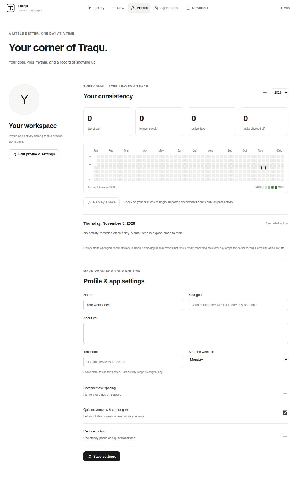
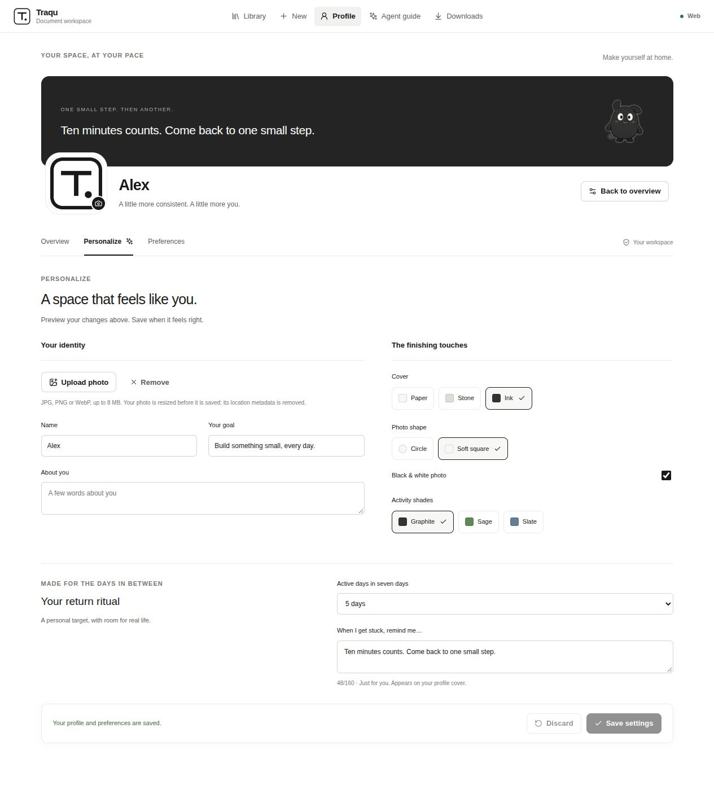
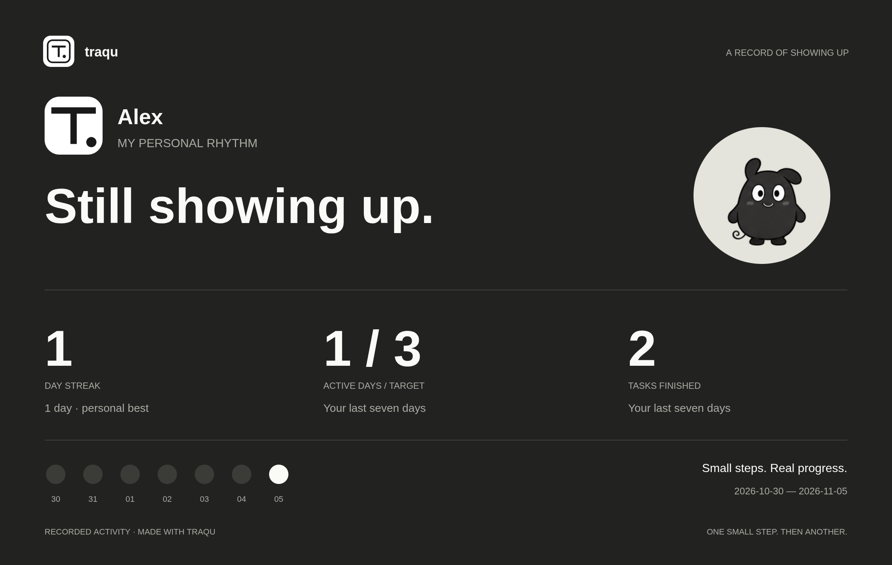

# Profile studio audit and update

Reviewed the running profile, customization flow, and phone layout. The audit used an isolated copy of the workspace; the installed workspace was not changed. Screenshots use an example identity and the public app icon as the photo fixture.

1. **Overview — improved.** Previously the page combined a full-year empty calendar, personal details and all settings in one long view. The new overview separates identity, goal, a seven-day rhythm, activity and history. Statistics explicitly distinguish the current streak from lifetime totals.
2. **Personalize — implemented and verified.** Upload a JPG, PNG or WebP; crop, zoom and reposition it; choose a circular or rounded photo and optional monochrome treatment. Images are resized to 256 pixels and re-encoded before saving. The backend validates actual raster images, dimensions and size. SVG and remote image URLs are rejected. Choose Paper, Stone or Ink covers and Graphite, Sage or Slate activity shades. Live preview, explicit save and discard make the effect of each choice clear.
3. **Return ritual — implemented.** Choose a personal active-day target from 1 to 7 and leave a short note for difficult days. Targets use actual completions in the last seven days, across year boundaries. A 2400 × 1520 PNG profile card combines the actual profile photo, Qu, and aggregate progress. A live preview offers Paper, Stone or Ink finishes, three headlines, and controls to hide the name/photo or explicitly include the goal (off by default). Task details and the private return note never appear. Save to computer or open the device share chooser; unsupported share APIs fall back to saving a PNG to attach to any message. Traqu never sends it to another person automatically.
4. **Preferences — improved.** Timezone, week start, compact spacing and motion controls are separate from identity editing. Settings support keyboard interaction, labelled controls and visible save feedback. Loading failures have retry actions. On phones the save footer remains in document flow so it cannot cover fields.
5. **History — improved.** The calendar has a single keyboard tab stop, arrow-key date navigation and a date picker for easier touch and keyboard access. History failures show a retry rather than a permanent loading message. Same-day undo, later reopening, backup identity and imported-checkmark rules still apply.
6. **Cross-platform checks — automated.** Profile storage and backups are covered by backend tests. Electron tests upload, crop, save and reload a photo, select appearance options, change the personal target, preserve history and exercise reduced motion. Android's offline store has tests for daily metadata, duplicate sections, atomic changes, undo, year boundaries, editor revisions and additive backup restoration. Native CI includes Windows ARM64 and an Android emulator test of profile persistence and daily import without an API server.

## Limits

Screenshots do not establish complete accessibility compliance. Android PDF and DOCX imports use selectable text rather than the desktop layout-aware parser: use Traqu JSON for complex tables. CSV and legacy flat-import recovery are desktop features. Android preview data is separate from desktop; transfer a workspace backup manually. The preview APK is debug-signed and is not a production Play Store release; durable production signing must be configured before promising seamless Android upgrades.

